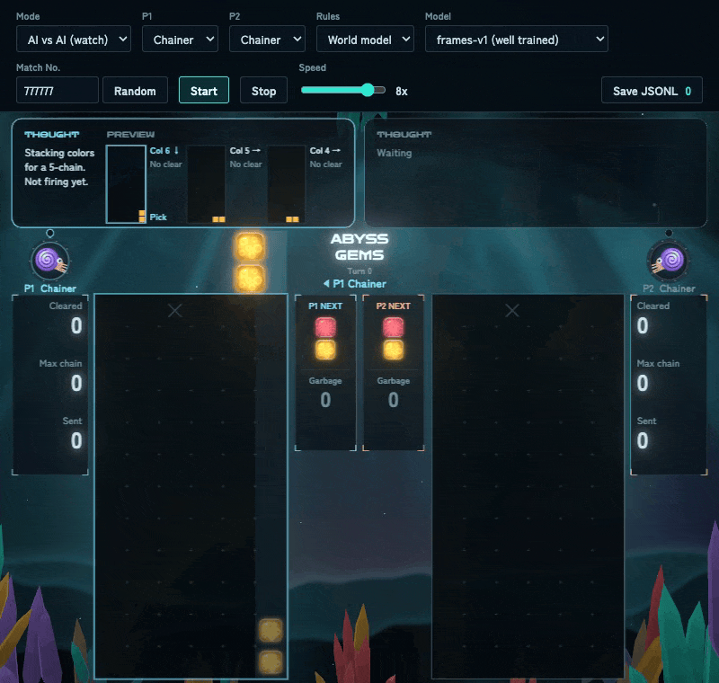
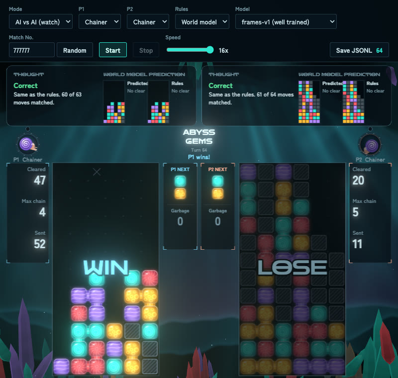
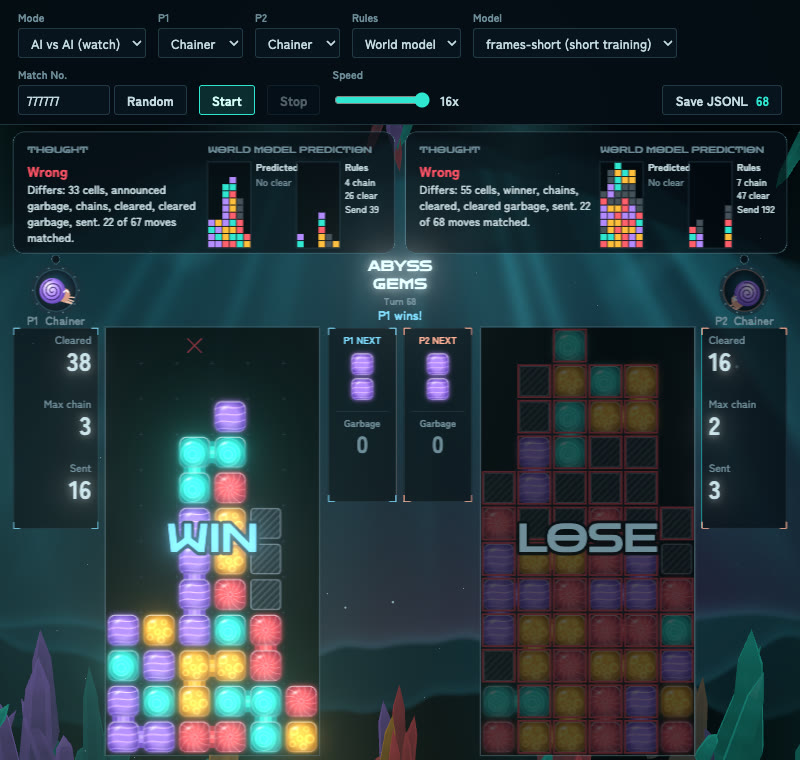

# ABYSS GEMS

[English](README.md)

**世界モデル**を小さく試す実験です。題材として、ターン制の落ちもの対戦パズルを作り、そのルールの代わりに世界モデルで試合を進めます。世界モデルとは、今の局面と手から次の局面を予測するニューラルネットのことです。

学習済みの世界モデルを 2 つ同梱しており、ブラウザの中で動きます。ルールではなくモデルが結果を決める試合を、遊んだり観戦したりできます。

**ブラウザですぐ遊べます：** https://snc2work.github.io/abyss-gems/



| よく学習したモデル（`frames-v1`） | 学習の短いモデル（`frames-short`） |
| --- | --- |
|  |  |
| 64 手中 61 手が本物のルールと一致。普通の試合になります。 | 68 手中 22 手が一致。P2 の 7 連鎖がモデルの中では起きず、P2 が埋まって負けます。 |

## 取り組み方

- **正解が分かる題材にする：** ゲームを自分で作ったので、本物のルールが手元にあります。モデルの答えが合っているかを毎手確かめられます。
- **学習データを作りやすくする：** ゲームに、学習データを作る機能を最初から入れました。ブラウザなしで大量の試合を回し、対戦カードやランダムな手を混ぜて、1 手ごとに途中のコマまで記録できます（`npm run dataset`）。
- **ルールだけを差し替える：** ルールを描画やプレイヤーと分けて作り、同じ画面・同じプレイヤーのまま、ルールの代わりにモデルで試合を進められるようにしました。
- **毎手、ルールと比べる：** 画面にモデルの答えとルールの答えを並べ、違うところを示します。
- **出来の違う 2 つのモデルで比べる：** 構成もデータも同じで、学習の長さだけが違うモデルを用意し、モデルの出来が試合にどう表れるかを見ます。

## この世界モデルについて

小さな CNN（畳み込みニューラルネット）を中心にした、合計約 131 万パラメータのモデルです。盤面（6 列 × 13 行）を画像のように扱います。1 手の結果を一度に出すのではなく、次の 1 コマだけを予測し、盤面が変わらなくなるまで繰り返します。コマとは、ブロックを置く、1 行落ちる、消える、といった画面の動きの 1 段階のことです。最初に 1 手の結果をまとめて出す形で CNN と Transformer を比べ、CNN のほうが良かったので、CNN をもとに今の形へ進めました。

1 つのモデルは、次の 3 つの部品でできています。同梱の 2 つのモデルは、どちらも同じ形です。

| 部品 | 形 | パラメータ数 |
| --- | --- | ---: |
| コマモデル（次の 1 コマ） | 残差 CNN（幅 48、8 ブロック） | 39.4 万 |
| 集計モデル（おじゃまの数） | 全結合 3 層（幅 256） | 61.3 万 |
| おじゃまモデル（相手の盤面と勝者） | 残差 CNN（幅 48、6 ブロック） | 29.9 万 |

ファイルの大きさは 1 モデル約 6 MB です。

## ルール

- 盤面は 6 列 × 12 行に、見えない 13 行目を加えたものです。プレイヤーごとに 1 盤面を持ちます。
- ブロックは 4 色で、2 個 1 組で出現します。両プレイヤーは同じ順番の組を受け取ります。
- 手番のプレイヤーが列と向きを選ぶと即座に配置され、落下 → 消去 → 再落下を消えなくなるまで繰り返します（連鎖）。
- 同色 4 個以上が縦横につながると消えます。
- 消すと、相手におじゃまブロックを送ります。連鎖が長いほど多く送れます。送ったおじゃまは、まず数だけが**予告**として表示されます。受ける側は次の 1 手で消して相殺でき、残った分はその次の手番の始めに降ってきます。
- おじゃまは、隣で色ブロックが消えると一緒に消えます。
- 出現位置（3 列目の最上段）が埋まると負けです。

## プレイヤーの種類

画面の P1・P2 で選べるプレイヤーです。どれも、手の選び方を決めて書いた小さなプログラムです。

| 画面の名前 | 考え方 | アイコン |
| --- | --- | --- |
| Random | 置ける手からランダムに選ぶ | クラゲ |
| Greedy | 今この瞬間に一番多く消せる手を選ぶ。連鎖は狙わない | チョウチンアンコウ |
| Chainer | 連鎖を組み、十分に育つか盤面が危なくなるまで撃つのを待つ | オウムガイ |

人のアイコンは潜水ヘルメットです。

## 起動方法

Node.js 22.12 以上が必要です。

```bash
npm install
```

```bash
npm run dev
```

表示された URL（通常は http://localhost:5173 ）を開きます。

## 遊び方

画面の表記は英語です。画面上部で、モード（Human vs AI / AI vs AI）、プレイヤーの種類、ルール（Rules）、対戦番号（Match No.）、速度を選びます。Rules の `Built-in` は本物のルールで、`World model` にすると世界モデルが試合を進めます（下の「世界モデルで遊ぶ」）。

**対戦番号**は乱数のシードです。ブロックの順番と、おじゃまが降るランダムな列が決まるので、同じ番号と同じプレイヤーなら同じ試合になります（人が打つ場合は、同じ手を打てば同じ展開になります）。Random ボタンを押すと、ランダムな番号に変わります。

Start で対戦を始め、Stop でその対戦を終わらせます。Stop の後も、そこまでの記録は Save JSONL で保存できます。対戦中に Start を押すと、今の対戦を終えて新しい対戦を始めます。

| 操作 | キーボード | マウス |
| --- | --- | --- |
| 列の移動 | ← → または A D | 盤面の上で動かす |
| 回転 | ↑ / W / X（Z で逆回転） | 右クリック、ホイール |
| 決定 | Enter / Space / ↓ / S | 左クリック |

## 世界モデルで遊ぶ

1. Rules を `World model` にします。
2. Model でモデルを選びます。`frames-v1 (well trained)` がよく学習したモデル、`frames-short (short training)` が学習の短いモデルです。
3. 観戦するなら Mode を `AI vs AI (watch)` にします。`Human vs AI` のままなら自分で打てます。
4. Start を押します。最初の 1 手は、モデル（約 6 MB）と ONNX Runtime の読み込みで少し待ちます。

アドレスでも選べます：http://localhost:5173/?model=frames-short

### 画面の見方

- **盤面はモデルの答えです。** モデルは途中のコマも返すので、置く・落ちる・連鎖のアニメーションもモデルが作ったものです。ルールが決めるのは、手番の順番と次に来るブロックだけです。
- **裏で本物のルールも動いています。** モデルの盤面がルールの盤面と違うマスに、赤い枠が付きます。
- **各プレイヤーの上の吹き出し**は、1 手の中で 2 つの表示に切り替わります。
  - **手を選ぶとき（THOUGHT / PREVIEW）：** プレイヤーの考えと、候補の手（最大 3 つ）を打ったあとの盤面です。プレイヤーは本物のルールで先読みしているので、この盤面もルールで計算しています。
  - **手を打ったあと（WORLD MODEL PREDICTION）：** 世界モデルが予測した次の盤面を、ルールの答えと並べて見せます。予測が当たれば緑で Correct、外れれば赤で Wrong と出ます。左の小さな盤面（Predicted）がモデルの予測、右（Rules）がルールの答えです。外れたときは違った項目（マス、おじゃまの予告、連鎖数、勝者など）も出ます。ここまでに当たった手の数も出ます。

## 2 つのモデルの比較

構成も学習データも同じで、学習の長さだけが違います。学習に使っていない 120 試合（10,149 手）で測りました。

| | `frames-v1` | `frames-short` |
| --- | --- | --- |
| 学習時間 | 約 37 分 | 約 9 分 |
| 次の盤面（両者とも）が完全に当たった手 | **96.93%** | 48.65% |
| 　連鎖なしの手 | 98.72% | 57.88% |
| 　1 連鎖 | 93.73% | 21.60% |
| 　2 連鎖 | 90.08% | 2.38% |
| 　3 連鎖 | 76.92% | 1.54% |
| 　4 連鎖以上 | 62.07% | 0% |
| おじゃまの予告が当たった手 | 98.43% | 85.76% |
| 決着した手で、勝者が当たった割合 | 89.2% | 85.0% |
| モデルだけで試合を進めたとき、記録の試合とずれ始めるまでの手数（平均） | 46.57 | 2.63 |

最後の確認用に取っておいた別の 500 試合（39,681 手）でも、`frames-v1` は 96.93% の手で次の盤面が完全に当たりました。ブロックを置くだけで何も消さない単純な予測は 63.26% です。

### ゲーム画面での結果

プレイヤーは両者とも Chainer です。表の対戦番号を画面の Match No. に入れ、同じ設定で Start すると、同じ試合を再現できます。どちらの番号も、学習にも確認にも使っていません。

| 対戦番号 | モデル | 手数 | ルールと一致した手 | 結末 |
| --- | --- | ---: | ---: | --- |
| 777777 | `frames-v1` | 64 | 61 | P1 の勝ち |
| 870515 | `frames-v1` | 45 | 40 | P1 が 6 連鎖で勝ち。最後の手は、降ったおじゃまの数だけが違う |
| 777777 | `frames-short` | 68 | 22 | P2 が 7 連鎖（ルールではおじゃま 192 個）を打つが、モデルの中では何も消えない。P2 が埋まって負け |
| 870515 | `frames-short` | 56 | 24 | 5 連鎖（おじゃま 60 個）で同じことが起きる |

Chainer は本物のルールで先を読み、連鎖を組んで打ちます。ところが学習の短いモデルでは連鎖が起きないので、勝つはずだった側が自分で埋まります。

## モデルの学習方法

モデルは別のプロジェクトで、Python と PyTorch で作りました。学習のコードはこのリポジトリに含めていません。ここにあるのは、書き出したモデル（`public/models/`）、それをブラウザで動かす処理（`src/model/localModel.ts`）、その処理が Python 版と同じ答えを返すことを確かめるテスト（`tests/localModel.test.ts`）です。

1. **データ：** このゲームの組み込みルールで、プレイヤーの種類を混ぜ、ランダムな手も一部入れて、1000 試合対戦させました（`npm run dataset`）。1 手ごとに、途中のコマをすべて記録しています。880 試合で学習し、120 試合を確認用に取っておきました。
2. **1 コマずつ予測する理由：** 1 手の結果を一度に出す形では、2 連鎖以上の手がほとんど当たりませんでした。1 コマずつなら、1 回の予測は「落ちる」か「消える」の小さな変化で済みます。モデルが「消える」と答えたコマの数が、そのまま連鎖数になります。
3. **部品ごとの学習：** 3 つの部品（上の表）は、別々に学習しました。
4. **おじゃまの降る列だけは補助：** おじゃまの数が 6 列で割り切れないと、余りはランダムな列に降ります。これは予測できないので、モデルが予測した数だけ、モデルが一番おじゃまらしいと答えたマスから順に積み直しています。
5. **ブラウザで動かす：** 各部品を ONNX 形式に書き出し、[ONNX Runtime Web](https://onnxruntime.ai/)（WebAssembly）で動かしています。上のテストで、[docs/samples/sample-game.jsonl](docs/samples/sample-game.jsonl) の全手について、ブラウザ版の答えが途中のコマまで Python 版と完全に同じことを確かめています。

## 開発者向けの情報

ゲームを改造したい人や、このゲームで自分の世界モデルを作ってみたい人向けの情報です。コマンド、ファイル構成、ログの形式、学習データとセルフプレイの作り方を説明します。TypeScript と Vite で作っています。描画は Canvas 2D と three.js、世界モデルの実行は ONNX Runtime Web です。

### コマンド

| コマンド | 内容 |
| --- | --- |
| `npm run dev` | 開発サーバーを起動 |
| `npm run build` | 型チェックと本番ビルド（`dist/`） |
| `npm test` | ユニットテスト |
| `npm run selfplay -- <オプション>` | ブラウザなしで対戦してデータを生成 |
| `npm run dataset -- <オプション>` | 世界モデルの学習データを生成 |
| `npm run model:mock` | 本物のルールで答える仮のモデルサーバーを起動 |

### ファイル構成

```
src/
  engine/   ルール（純粋関数）。DOM と Math.random を使わず、Node.js でも動く
  players/  プレイヤー（Human / Random / Greedy / Chainer）
  logger/   JSONL 記録
  game/     手番進行。match.ts はブラウザとセルフプレイで共通
  render/   Canvas 2D の描画と、three.js の背景・発光・粒子
  ui/       人の入力（マウスとキーボード）
  dataset/  学習データの生成計画（対戦カード、ランダムな手、検証用の分割）
  model/    世界モデル：ブラウザ内のモデル、サーバーとの接続、回答の検査、ルールとの比較
  lib/      シード付き乱数
public/models/
  frames-v1/, frames-short/  書き出した世界モデル（コマ・集計・おじゃまの部品、ONNX 形式）
scripts/
  selfplay.ts  ブラウザなしの大量対戦
  dataset.ts   世界モデルの学習データ生成
  model-server.ts  本物のルールで答える仮のモデルサーバー
tests/
  fixtures/  Python のモデルサーバーの回答（ブラウザ内のモデルのテスト用）
```

ルールの定数と計算式は [src/engine/config.ts](src/engine/config.ts) にまとめています。ただし、色数は 4 以下にしてください（5 はおじゃまの値で、配色も 4 色分です）。

### ログの形式（JSONL）

1 手につき 1 行です。ブラウザでは「Save JSONL」ボタンで、その試合の記録を保存します。

```jsonc
{
  "seed": 123,
  "turn": 0,                 // 0 始まりの通し番号
  "player": 0,               // この手を打ったプレイヤー
  "board_self": [[...]],     // 手を打つ前の自分の盤面
  "board_opp": [[...]],      // 手を打つ前の相手の盤面
  "pair": [1, 3],            // [軸, 子] の色
  "next": [2, 2],
  "garbage_pending": { "self": 0, "opp": 0 },  // 手を打つ前の予告数
  "move": { "column": 2, "rotation": 0 },
  "frames": [ /* 途中のコマ：置く、落ちる、消える、おじゃまが降る */ ],
  "next_board_self": [[...]],  // 手を打った後の自分の盤面
  "next_board_opp": [[...]],   // 相手の手番開始時のおじゃまが降った後の相手の盤面
  "events": { /* 連鎖数、消えた数、おじゃまの数、勝者 */ }
}
```

### 世界モデルの学習データ

```bash
npm run dataset -- --games 10000 --out data/v1
```

複数の対戦カードを混ぜて、学習用と検証用に分けて保存します。止めても同じコマンドで続きから作れます。既定の設定で 1 万試合は約 1.6 時間、約 3 GB です（100 試合の実測からの計算）。

### セルフプレイ

```bash
npm run selfplay -- --games 10000 --p1 random --p2 greedy
```

| オプション | 既定値 | 内容 |
| --- | --- | --- |
| `--games` | 100 | 試合数 |
| `--p1` / `--p2` | random / greedy | `random`（Random）、`greedy`（Greedy）、`chain`（Chainer）のいずれか |
| `--seed` | 1 | 最初の試合のシード（以降 1 ずつ増える） |
| `--out` | `data/selfplay-<p1>-vs-<p2>-<games>.jsonl` | 出力先 |

`frames` を含むのでファイルは大きくなります。目安は 1 試合あたり、Random 対 Greedy で約 0.22 MB、Greedy 同士で約 0.76 MB です。Chainer は先読みをする分だけ遅く、Chainer 同士で 1 秒に約 1 試合です。

## ライセンス

[MIT](LICENSE) です。`public/models/` の学習済みモデルも含みます。同梱しているフォント（Zen Dots、Zen Kaku Gothic New）は [SIL Open Font License 1.1](https://openfontlicense.org/) です。
