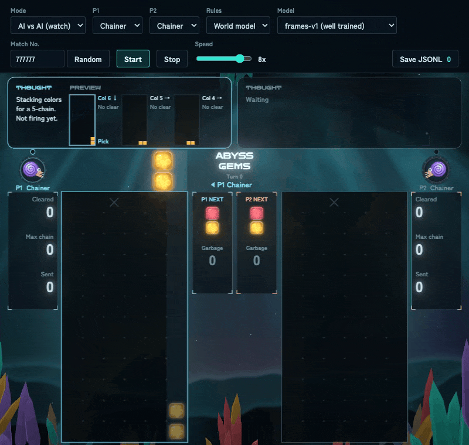
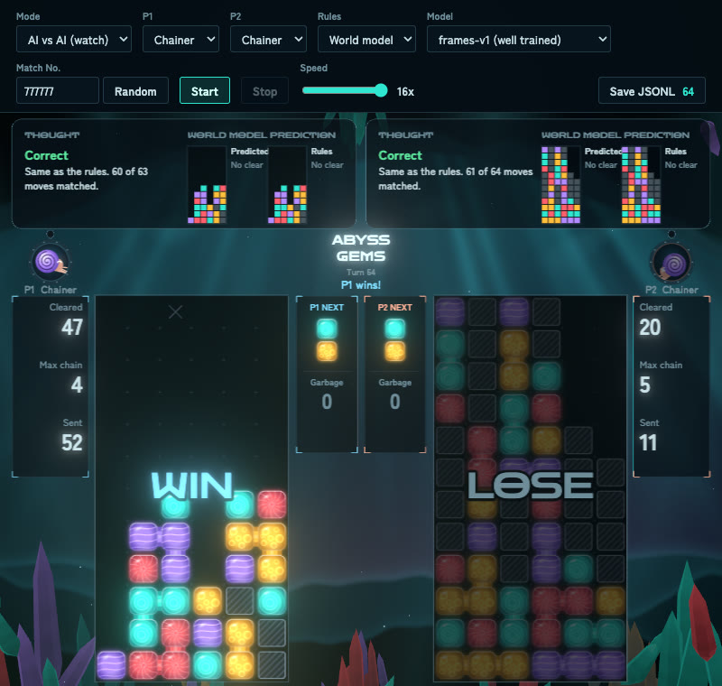
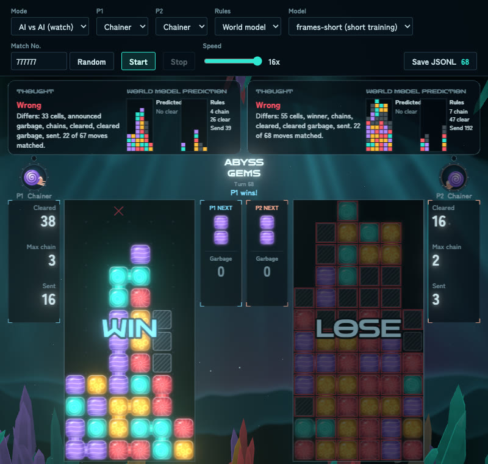

# ABYSS GEMS

[日本語](README.ja.md)

A small experiment with **world models**. Its subject is a turn-based, two-player falling-block puzzle made for it, whose matches are run by a world model instead of the rules. A world model here is a neural network that predicts the next state of the game from the current state and a move.

Two trained world models ship with the game and run inside the page. You can play or watch a match where the model, not the rules, decides what happens.

**Play it in your browser:** https://snc2work.github.io/abyss-gems/



| Well-trained model (`frames-v1`) | Short-trained model (`frames-short`) |
| --- | --- |
|  |  |
| 61 of 64 moves match the real rules. A normal game. | 22 of 68 moves match. P2's 7-chain never goes off inside the model, and P2 is buried. |

## Approach

- **A subject with a known answer.** The game is made here, so its real rules are at hand, and every answer of the model can be checked.
- **Make training data easy to produce.** The game has a training-data generator built in from the start. It runs many matches without a browser, mixes match-ups and random moves, and logs every move down to its intermediate frames (`npm run dataset`).
- **Swap only the rules.** The rules are kept apart from drawing and players, so the same screen and the same players can run on the model instead.
- **Compare with the rules on every move.** The screen shows the model's answer next to the rules' answer and marks where they differ.
- **Two models of different quality.** Same structure, same data, only the training length differs, to see how a model's quality shows up in a match.

## About the world model

A model built mainly from small CNNs (convolutional neural networks), about 1.31 million parameters in all. It treats the board (6 columns × 13 rows) like an image. Instead of the whole result of a move at once, it predicts only the next frame and repeats until the board stops changing. A frame is one step of what you see on screen: placing the pair, a one-row fall, or a clear. CNNs and Transformers were first compared on predicting a whole move at once. CNNs did better, so the current form was built on them.

One model is made of the three parts below. Both shipped models have the same shape.

| Part | Shape | Parameters |
| --- | --- | ---: |
| Frame model (the next frame) | Residual CNN (width 48, 8 blocks) | 394k |
| Ledger model (garbage counts) | MLP, 3 layers (width 256) | 613k |
| Drop model (the opponent's board and the winner) | Residual CNN (width 48, 6 blocks) | 299k |

Each model is about 6 MB on disk.

## Rules

- Each player has a board of 6 columns × 12 rows, plus a hidden 13th row.
- Blocks come in 4 colors, in pairs. Both players receive the same sequence of pairs.
- The player to move picks a column and a rotation. The pair is placed at once, then blocks fall, clear and fall again until nothing more clears (a chain).
- 4 or more blocks of one color connected up, down, left or right clear.
- Clearing sends garbage blocks to the opponent; longer chains send more. Sent garbage first shows only as a number, the **announcement**. The receiver can offset it by clearing on their next move, and whatever is left falls at the start of their turn after that.
- Garbage clears when color blocks next to it clear.
- A player loses when the spawn cell (3rd column, top row) is filled.

## Player types

The players you choose in P1 and P2 on screen. Each is a small hand-written program with fixed steps for choosing a move.

| On screen | Idea | Icon |
| --- | --- | --- |
| Random | Picks any legal move | Jellyfish |
| Greedy | Clears as much as it can right now; never plans chains | Anglerfish |
| Chainer | Builds a chain and waits to fire it until it is big enough or the board gets dangerous | Nautilus |

The human player's icon is a diving helmet.

## Quick start

Requires Node.js 22.12 or later.

```bash
npm install
```

```bash
npm run dev
```

Open the URL it prints (usually http://localhost:5173).

## How to play

The top bar sets the mode (Human vs AI / AI vs AI), the player types, the rules (Rules), the match number (Match No.) and the speed. `Built-in` under Rules is the real rules; `World model` lets a world model run the match (see "Playing with a world model" below).

The **match number** is the random seed. It fixes the sequence of pairs and the random columns of garbage, so the same number with the same players gives the same match (with a human player, the same moves give the same game). **Random** picks a new number.

**Start** begins a match and **Stop** ends it. After Stop, **Save JSONL** still saves the log so far. Pressing Start during a match ends it and starts a new one.

| Action | Keyboard | Mouse |
| --- | --- | --- |
| Move | ← → or A D | Move over the board |
| Rotate | ↑ / W / X (Z rotates back) | Right click, wheel |
| Drop | Enter / Space / ↓ / S | Left click |

## Playing with a world model

1. Set **Rules** to `World model`.
2. Pick a **Model**: `frames-v1 (well trained)` or `frames-short (short training)`.
3. Set **Mode** to `AI vs AI (watch)` to watch, or keep `Human vs AI` to play.
4. Press **Start**. The first move waits a moment while the model (about 6 MB) and ONNX Runtime load.

You can also choose the model in the address: http://localhost:5173/?model=frames-short

### Reading the screen

- **The boards are the model's answer.** The model also returns its intermediate frames, so placing, falling and chain animations come from the model too. The rules only supply the turn order and the next pairs.
- **The real rules run alongside.** Cells where the model's board differs from the rules' board get a red frame.
- **The bubble above each player** switches between two views within a move.
  - **While choosing (THOUGHT / PREVIEW):** the player's reasoning and the board after each candidate move (up to 3). Players look ahead with the real rules, so these boards come from the rules.
  - **After the move (WORLD MODEL PREDICTION):** the next board the world model predicted, next to the rules' answer. A right prediction shows a green Correct, a wrong one a red Wrong. The small board on the left (Predicted) is the model's prediction and the one on the right (Rules) is the rules' answer. A wrong prediction also says what differed (cells, announced garbage, chains, winner, …). It also shows how many moves have matched so far.

## Comparing the two models

Both have the same structure and were trained on the same data. Only the training length differs. Measured on 120 matches (10,149 moves) not used for training.

| | `frames-v1` | `frames-short` |
| --- | --- | --- |
| Training time | about 37 min | about 9 min |
| Next boards (both players) exactly right | **96.93%** | 48.65% |
| … moves with no chain | 98.72% | 57.88% |
| … 1 chain | 93.73% | 21.60% |
| … 2 chains | 90.08% | 2.38% |
| … 3 chains | 76.92% | 1.54% |
| … 4 or more chains | 62.07% | 0% |
| Garbage announcement right | 98.43% | 85.76% |
| Winner right, on moves that end the game | 89.2% | 85.0% |
| Moves until the model's own game drifts from the logged one (mean) | 46.57 | 2.63 |

On another 500 matches (39,681 moves) kept aside for a final check, `frames-v1` also got the next boards exactly right on 96.93% of moves. A simple prediction that only places the pair and never clears anything gets 63.26%.

### On the game screen

Both players are Chainer. Type a match number from the table into **Match No.** and press Start with the same settings to replay the same match. Neither number was used for training or checking.

| Match No. | Model | Moves | Moves that match the rules | How it ended |
| --- | --- | ---: | ---: | --- |
| 777777 | `frames-v1` | 64 | 61 | P1 wins |
| 870515 | `frames-v1` | 45 | 40 | P1 wins with a 6-chain. Only the number of fallen garbage differs on the last move |
| 777777 | `frames-short` | 68 | 22 | P2 sets off a 7-chain (192 garbage by the rules), but nothing clears in the model. P2 is buried and loses |
| 870515 | `frames-short` | 56 | 24 | Same story with a 5-chain (60 garbage) |

Chainer plans with the real rules. It builds chains and fires them, but the short-trained model does not let the chain happen, so the player who should have won buries itself.

## How the models were trained

The models were made in a separate project with Python and PyTorch. That code is not part of this repository. What ships here are the exported models (`public/models/`), the loop that runs them in the page (`src/model/localModel.ts`), and a test that checks the loop against the Python version's replies (`tests/localModel.test.ts`).

1. **Data.** This game's built-in rules played 1,000 matches with a mix of player types and some random moves (`npm run dataset`). Each move is logged with every intermediate frame. 880 matches were used for training and 120 kept aside for checking.
2. **Why one frame at a time.** Predicting the whole result of a move at once got almost no 2-chain moves right. One frame at a time, each prediction is a small change: a fall or a clear. The number of frames the model calls a clear is the chain length.
3. **Parts trained separately.** The three parts (in the table above) were trained one by one.
4. **Help only for garbage columns.** When the garbage count does not divide evenly over the 6 columns, the rest falls in random columns, which cannot be predicted. So the model's predicted number of blocks is stacked again, starting with the cells the model scores most likely to be garbage.
5. **Running in the browser.** Each part was exported to ONNX and runs with [ONNX Runtime Web](https://onnxruntime.ai/) (WebAssembly). The test above checks that the browser version gives exactly the same replies as the Python version, frames included, for every move of [docs/samples/sample-game.jsonl](docs/samples/sample-game.jsonl).

## For developers

For those who want to modify the game or build their own world model with it. This section covers the commands, the files, the log format, and how to generate training data and self-play logs. Built with TypeScript and Vite. Drawing uses Canvas 2D and three.js, and the world models run on ONNX Runtime Web.

### Commands

| Command | What it does |
| --- | --- |
| `npm run dev` | Start the development server |
| `npm run build` | Type-check and build for production (`dist/`) |
| `npm test` | Unit tests |
| `npm run selfplay -- <options>` | Play matches without a browser and save the logs |
| `npm run dataset -- <options>` | Generate training data for a world model |
| `npm run model:mock` | Start a mock model server that answers with the real rules |

### Files

```
src/
  engine/   The rules, as pure functions. No DOM and no Math.random; also runs in Node.js
  players/  Players (Human / Random / Greedy / Chainer)
  logger/   JSONL logs
  game/     Turn handling. match.ts is shared by the browser and self-play
  render/   Canvas 2D drawing, with a three.js background, glow and particles
  ui/       Human input (mouse and keyboard)
  dataset/  Training data plans (match-ups, random moves, validation split)
  model/    World models: the in-page model, the server connection, reply checks, comparison with the rules
  lib/      Seeded random numbers
public/models/
  frames-v1/, frames-short/  The exported world models (frame, ledger and drop parts in ONNX)
scripts/
  selfplay.ts       Many matches without a browser
  dataset.ts        World model training data
  model-server.ts   A mock model server that answers with the real rules
tests/
  fixtures/         The Python model server's replies, for the in-page model's test
```

Rule constants and formulas live in [src/engine/config.ts](src/engine/config.ts). Keep the number of colors at 4 or fewer (5 is the garbage value, and the palette has 4 colors).

### Log format (JSONL)

One line per move. In the browser, **Save JSONL** saves the match's log.

```jsonc
{
  "seed": 123,
  "turn": 0,                 // counted from 0
  "player": 0,               // who made this move
  "board_self": [[...]],     // the mover's board before the move
  "board_opp": [[...]],      // the opponent's board before the move
  "pair": [1, 3],            // [pivot, child] colors
  "next": [2, 2],
  "garbage_pending": { "self": 0, "opp": 0 },  // announcements before the move
  "move": { "column": 2, "rotation": 0 },
  "frames": [ /* intermediate frames: place, fall, clear, garbage */ ],
  "next_board_self": [[...]],  // the mover's board after the move
  "next_board_opp": [[...]],   // the opponent's board after garbage falls at the start of their turn
  "events": { /* chains, cleared blocks, garbage counts, winner */ }
}
```

### World model training data

```bash
npm run dataset -- --games 10000 --out data/v1
```

Mixes several match-ups and saves training and validation splits. Running the same command again continues where it stopped. With the defaults, 10,000 matches take about 1.6 hours and 3 GB (estimated from 100 matches).

### Self-play

```bash
npm run selfplay -- --games 10000 --p1 random --p2 greedy
```

| Option | Default | Meaning |
| --- | --- | --- |
| `--games` | 100 | Number of matches |
| `--p1` / `--p2` | random / greedy | `random` (Random), `greedy` (Greedy) or `chain` (Chainer) |
| `--seed` | 1 | Seed of the first match (then +1 each) |
| `--out` | `data/selfplay-<p1>-vs-<p2>-<games>.jsonl` | Output file |

Logs include `frames`, so files get large: about 0.22 MB per match for Random vs Greedy, and 0.76 MB for Greedy vs Greedy. Chainer reads ahead and is slower, about one Chainer-vs-Chainer match per second.

## License

[MIT](LICENSE), including the trained models in `public/models/`. The bundled fonts, Zen Dots and Zen Kaku Gothic New, are under the [SIL Open Font License 1.1](https://openfontlicense.org/).
